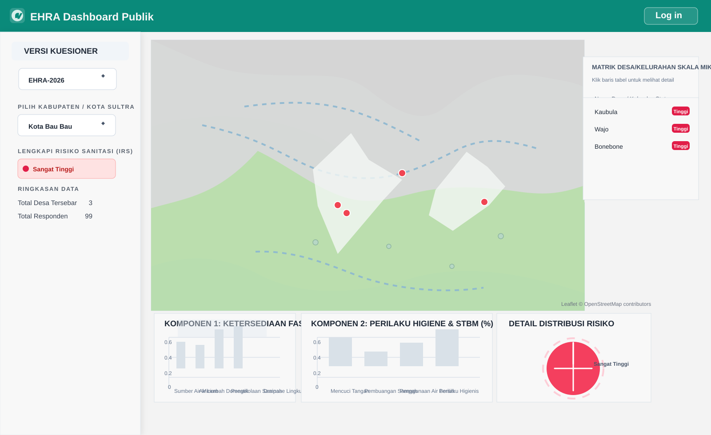

# EHRA-APP Documentation

EHRA-APP is a web-based Environmental Health Risk Assessment (EHRA) application designed to support data collection, analysis, risk scoring, and operational reporting for environmental health programs. The platform combines GIS-based visualization, dynamic questionnaire logic, and dashboard reporting to help local governments monitor sanitation and environmental risk conditions.



## Project Overview

This application is built for public health and environmental monitoring workflows. It allows administrators to:

- design dynamic questionnaires for EHRA assessments
- assess risk factors using weighted scoring logic
- collect field data from enumerators on mobile-friendly forms
- visualize results by district, village, and risk category
- review operational dashboards with geographic and statistical views

Typical use cases include:

- sanitation risk assessment in villages or sub-districts
- monitoring environmental health conditions
- evaluating risk distribution across areas
- producing data-driven decisions for intervention planning

## Core Features

### 1. Dynamic Questionnaire Builder
- create and manage EHRA questions
- support multiple answer types such as single choice, text, number, and structured inputs
- configure skip logic and conditional flows
- manage assessment versions and assessment metadata

### 2. Risk Scoring and Weighting
- assign risk conditions and weights to questionnaire answers
- calculate sanitary risk index based on configured scoring rules
- summarize results by village, region, or assessment period

### 3. Enumerator App Experience
- optimized layout for field data collection on mobile devices
- geotagging support and location-aware information capture
- data collection flow designed for practical field use

### 4. GIS Dashboard and Mapping
- display risk categories on an interactive map
- color-coded indicators for high-risk and low-risk areas
- geographic overview for operational monitoring and reporting

### 5. Role-Based Access Control
- distinguish access between administrators, regional users, and field enumerators
- control visibility and data handling by user role

## Stack and Architecture

The application is built with a modern Laravel + React stack:

- Backend: Laravel 11 (PHP 8.2+)
- Frontend: React 18 + TypeScript
- User Interface: Tailwind CSS
- Routing and View Layer: Inertia.js
- Data Visualization: Chart.js and React Chart components
- Mapping: Leaflet + React-Leaflet
- Database: MariaDB / MySQL

This combination provides a fast single-page application experience while keeping a robust server-side backend for business logic, validation, and data storage.

## Project Structure

```bash
.
├── app/
│   ├── Http/
│   ├── Models/
│   └── ...
├── bootstrap/
├── config/
├── database/
│   ├── factories/
│   ├── migrations/
│   └── seeders/
├── public/
├── resources/
│   ├── js/
│   └── css/
├── routes/
├── storage/
├── tests/
├── .env.example
├── artisan
├── composer.json
├── package.json
├── phpunit.xml
├── README.md
├── vite.config.js
├── tailwind.config.js
└── ...
```

## Prerequisites

Before running the project locally, make sure the following are installed:

- PHP 8.2+
- Composer
- Node.js 18+
- npm
- MySQL or MariaDB
- Git

## Local Setup

### 1. Clone the repository

```bash
git clone https://github.com/Muh-Ikbal/EHRA-APP.git
cd EHRA-APP
```

### 2. Install PHP and Node dependencies

```bash
composer install
npm install
```

### 3. Configure environment variables

Create your local environment file and generate the application key:

```bash
cp .env.example .env
php artisan key:generate
```

Then edit `.env` and configure your database settings:

```env
DB_CONNECTION=mysql
DB_HOST=127.0.0.1
DB_PORT=3306
DB_DATABASE=ehra_app
DB_USERNAME=root
DB_PASSWORD=
```

### 4. Run database migrations and seed data

```bash
php artisan migrate --seed
```

If the application includes seeded users or sample data, this step initializes the default testing data and user accounts.

### 5. Start the app

Run the backend and frontend in separate terminals:

```bash
# Terminal 1
php artisan serve
```

```bash
# Terminal 2
npm run dev
```

Then open the app in a browser:

```text
http://localhost:8000
```

## Default Access / Seeded Accounts

If the project uses the default seeders, an admin account may be available for local testing. The project README already references the following example credentials:

```text
Email: admin@ehra.local
Password: password
```

If this differs in your environment, check the database seeders or authentication setup in the project.

## Environment Variables

The repository includes an `.env.example` file with standard Laravel application settings. At minimum, you should verify:

- app name and URL
- database connection credentials
- mail settings if email notifications are enabled
- cache/session configuration if needed in production

## Typical Workflow

1. Log in as an admin or designated user.
2. Configure the questionnaire structure and risk weights.
3. Collect field responses from enumerators.
4. Validate data integrity and geolocation entries.
5. Review dashboard charts and maps.
6. Export or report data for decision-making and intervention planning.

## Dashboard and Reporting

The dashboard includes several visual components, such as:

- geographic map view of villages or risk clusters
- summary panels for risk classification
- chart cards comparing sanitation factors and risk components
- distribution metrics for high-risk and low-risk areas

This makes the system suitable for operational monitoring and public health reporting.

## Notes for Development

- Use `npm run build` for production frontend builds.
- Use `php artisan test` for backend validation if tests are available.
- Follow Laravel and React conventions when adding new features.
- Keep mapping and scoring logic well documented when extending assessment rules.

## Related Project Files

The repository includes additional design and planning documents that can help you understand the system better:

- `PRD_EHRA.md` — product requirements document
- `Kuesioner_EHRA_2026.md` — questionnaire structure reference
- `EHRA_Database_Schema(1).md` — database schema documentation
- `implementation_plan.md` — implementation planning notes

## Licensing

This project is intended for internal or institutional use and may be subject to organizational licensing or confidentiality requirements. Confirm the legal usage rules before public deployment or redistribution.

## Summary

EHRA-APP is a practical GIS-enabled health risk assessment platform for monitoring environmental risks in the field. It connects dynamic questionnaire design, scoring logic, dashboard analytics, and map-based reporting into a single operational application.

This documentation should serve as a starting point for setup, understanding, and project onboarding.
